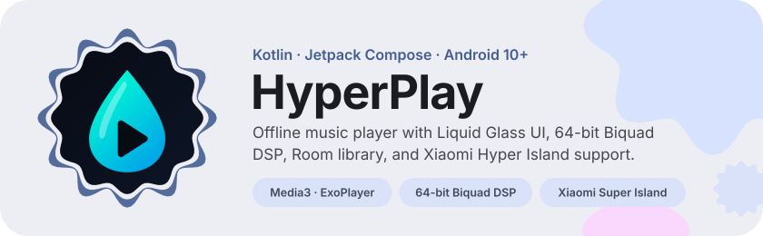

<div align="center">

<picture>
  <source media="(prefers-color-scheme: dark)" srcset="docs/m3/hero-en-dark.svg">
  
</picture>

<br/>

[](https://github.com/MrQuster/HyperPlay/releases/latest)
[](LICENSE)
[](https://github.com/MrQuster/HyperPlay/actions/workflows/ci.yml)
[-3E4759?style=for-the-badge&labelColor=1E2025)](app/build.gradle.kts)

**English** · [Русский](README.ru.md) · [Download APK](https://github.com/MrQuster/HyperPlay/releases/latest)

<picture>
  <source media="(prefers-color-scheme: dark)" srcset="docs/m3/wave-dark.svg">
  
</picture>

</div>

HyperPlay is an offline music player for Android 10 (API 29) and newer. It plays local audio files stored on the device, indexes large libraries in Room, and uses a translucent glass interface with real-time backdrop blur. The app does not request the `INTERNET` permission.

<!-- TODO: add a personal note here if you want, e.g., why you built HyperPlay alongside HyperBoost -->

## Audio engine and DSP

HyperPlay is built on AndroidX Media3 (`ExoPlayer` running inside a `MediaSessionService`). In addition to binding hardware audio effects (`Equalizer`, `LoudnessEnhancer`, `DynamicsProcessing`) to the player's audio session, it inserts a custom 64-bit `HyperPlayDspAudioProcessor` directly into the `ExoPlayer` audio sink:

- **Formats:** MP3, FLAC, AAC/M4A, OGG/Vorbis, OPUS, WAV, and other formats supported by the system decoder, including gapless playback and 16-bit/float PCM.
- **Working Bass & Surround on every device:** Many Android firmwares disable hardware `BassBoost` or `Virtualizer`. HyperPlay processes a 95 Hz Biquad low-shelf filter, Mid/Side stereo width, preamp gain, left/right balance, mono downmix, and a soft-knee (`tanh`) limiter directly inside the Media3 PCM pipeline.
- **Per-device profiles:** Automatically switches equalizer and gain settings between the phone speaker, Bluetooth headphones, wired headsets, and USB DACs.
- **ReplayGain, Crossfade, and Skip Silence:** Reads `REPLAYGAIN_TRACK_GAIN` tags, supports smooth fade transitions (0–12 s), and skips silent sections in tracks.

## Library and Now Playing

- **Fast Room index:** Scans `MediaStore` in the background and caches tracks in SQLite (Room) with normalized search keys (case- and diacritic-insensitive).
- **Sections:** Tracks, Favorites, Albums, Artists, Folders, Playlists, Genres, Recently Added, Recently Played, and Most Played.
- **M3U playlists:** Create and reorder playlists in the app, or import and export `.m3u` / `.m3u8` files.
- **Synced local lyrics (`.lrc`):** Reads `.lrc` files placed next to the audio file or embedded in tags and highlights lines in real time on the Now Playing screen.
- **Dynamic artwork colors:** Extracts accent colors from the current album cover using `Palette` and blurs the background under the bottom navigation bar and mini-player using `Haze`.

## Compatibility across Android devices

HyperPlay is an Android-only application. On startup, `DeviceProfileDetector` checks system properties and installed packages to select the appropriate notification and background behavior:

| Device / OS Family | Status | Notes |
| :--- | :--- | :--- |
| **Xiaomi 17T Pro (HyperOS 4, Android 17 / API 37)** | Tested on physical device | Full support: Media3 playback, Biquad DSP, Super Island (`miui.focus.param`) with track progress and `Prev / Play-Pause / Next` actions, HyperOS background setup shortcuts. |
| **Other Xiaomi / Redmi / POCO (HyperOS 1–3, MIUI 14)** | Expected to work (needs testing) | Uses the same focus notification format and HyperOS security center intents. |
| **Android 16+ devices (Pixel, Nothing, Motorola)** | Expected to work (needs testing) | Uses Android 16 promoted ongoing notifications (Live Updates) and standard AOSP media notifications. |
| **Samsung One UI, OnePlus OxygenOS, OPPO ColorOS, vivo, Honor** | Expected to work (needs testing) | Uses the standard Android Media3 notification with album art and seekbar, plus vendor-specific battery optimization guides. |

If you test HyperPlay on another phone, open the **System** tab, tap **Copy Diagnostic Report**, and share it in an Issue so we can update this table.

## Known limitations

- **Local files only:** HyperPlay does not stream music from online services or download lyrics/covers from the internet.
- **Xiaomi Super Island whitelist:** On some global HyperOS builds, `miui.systemui.plugin` restricts custom island layouts to whitelisted system packages. When that happens, the app still shows the standard Media3 notification in the shade and on the lock screen.

## Installation

1. Open [Releases](https://github.com/MrQuster/HyperPlay/releases/latest) and download `HyperPlay-vX.Y.Z.apk`.
2. Open the APK on your phone and allow installation. If Google Play Protect warns about an unknown developer, tap **More details** -> **Install anyway**.
3. Verify the SHA-256 checksum on Linux if needed:
   ```bash
   sha256sum -c HyperPlay-v1.0.0.apk.sha256
