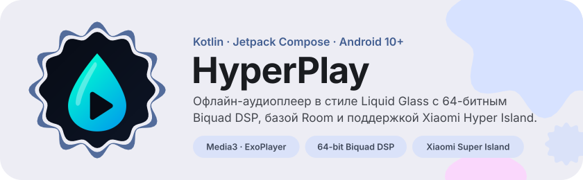

<div align="center">

<picture>
  <source media="(prefers-color-scheme: dark)" srcset="docs/m3/hero-ru-dark.svg">
  
</picture>

<br/>

[](https://github.com/MrQuster/HyperPlay/releases/latest)
[](LICENSE)
[](https://github.com/MrQuster/HyperPlay/actions/workflows/ci.yml)
[-3E4759?style=for-the-badge&labelColor=1E2025)](app/build.gradle.kts)

[English](README.md) · **Русский** · [Скачать APK](https://github.com/MrQuster/HyperPlay/releases/latest)

<picture>
  <source media="(prefers-color-scheme: dark)" srcset="docs/m3/wave-dark.svg">
  
</picture>

</div>

HyperPlay — офлайн-аудиоплеер для Android 10 (API 29) и новее. Он воспроизводит локальные музыкальные файлы с памяти телефона, индексирует большие фонотеки в базу Room и оформлен в виде полупрозрачных стеклянных панелей с размытием фона. Приложение не запрашивает разрешение `INTERNET`.

<!-- TODO: допиши от себя пару строк, если хочешь -->

## Звуковой движок и DSP

Плеер построен на базе AndroidX Media3 (`ExoPlayer` внутри `MediaSessionService`). Помимо привязки системных эффектов (`Equalizer`, `LoudnessEnhancer`, `DynamicsProcessing`) к аудиосессии плеера, внутрь декодера `ExoPlayer` встроен собственный 64-битный процессор `HyperPlayDspAudioProcessor`:

- **Форматы:** MP3, FLAC, AAC/M4A, OGG/Vorbis, OPUS, WAV и другие форматы, поддерживаемые системой, с бесшовным переходом (Gapless).
- **Рабочие ползунки баса и сцены на любом устройстве:** на многих прошивках аппаратные `BassBoost` и `Virtualizer` отключены. В HyperPlay биквадратный фильтр баса (Low-Shelf 95 Гц), расширение стереобазы (Mid/Side), предусилитель (Preamp), баланс Л/П, моно и мягкий лимитер (`tanh`) считаются напрямую в PCM-потоке плеера.
- **Профили для каждого выхода:** отдельные настройки эквалайзера и усиления для динамика телефона, каждых Bluetooth-наушников, проводной гарнитуры и USB-ЦАП.
- **ReplayGain, плавные переходы и пропуск тишины:** чтение тегов `REPLAYGAIN_TRACK_GAIN`, плавное затухание/нарастание громкости между треками (0–12 с) и автоматический пропуск тишины.

## Библиотека и экран Now Playing

- **Быстрый индекс в Room:** фоновое сканирование `MediaStore` с кешированием в SQLite (Room) и поиском без учёта регистра и диакритики (`ё` = `е`).
- **Разделы:** Треки, Избранное, Альбомы, Исполнители, Папки, Плейлисты, Жанры, Недавно добавленные, Недавно играли и Чаще всего.
- **Плейлисты M3U:** создание и редактирование плейлистов внутри плеера, импорт и экспорт файлов `.m3u` / `.m3u8`.
- **Синхронные тексты песен (`.lrc`):** чтение локальных файлов `.lrc` рядом с треком или встроенных тегов с подсветкой текущей строки и перемоткой по клику на куплет.
- **Цвета из обложки и размытие `Haze`:** акцентный цвет интерфейса плавно подстраивается под обложку текущего трека (`Palette`), а фон под нижней панелью и мини-плеером размывается в реальном времени.

## Работа на разных Android-устройствах

Приложение работает только на Android. При запуске модуль `DeviceProfileDetector` проверяет свойства прошивки и подбирает подходящий режим уведомлений:

| Устройство / Оболочка | Статус проверки | Что работает и особенности |
| :--- | :--- | :--- |
| **Xiaomi 17T Pro (HyperOS 4, Android 17 / API 37)** | Проверено на реальном устройстве | Воспроизведение Media3, Biquad DSP, управление в Суперострове (`miui.focus.param`) с прогрессом трека и кнопками `Назад / Пауза / Далее`, быстрые переходы в настройки автозапуска и батареи. |
| **Другие Xiaomi / Redmi / POCO (HyperOS 1–3, MIUI 14)** | Должно работать (нужна проверка) | Используется тот же формат фокусного уведомления и интенты безопасности Xiaomi. |
| **Смартфоны с Android 16+ (Pixel, Nothing, Motorola)** | Должно работать (нужна проверка) | Нативные уведомления реального времени Android 16+ (Live Updates) и стандартная медиа-шторка. |
| **Samsung One UI, OnePlus, OPPO, realme, vivo, Honor** | Должно работать (нужна проверка) | Стандартное медиауведомление Media3 с обложкой и перемоткой + инструкции настройки фона под конкретного вендора. |

Если вы проверили плеер на своём смартфоне, откройте вкладку **«Система»**, нажмите **«Скопировать отчёт»** и пришлите его в Issues.

## Установка из Releases

1. Перейдите в раздел [Releases](https://github.com/MrQuster/HyperPlay/releases/latest) и скачайте `HyperPlay-vX.Y.Z.apk`.
2. Откройте файл на телефоне и разрешите установку. Если Google Play Protect покажет предупреждение о неизвестном разработчике, нажмите **«Подробнее» → «Всё равно установить»**.

## Сборка из исходников (Arch Linux / Linux)

Понадобятся JDK 17 и Android SDK (API 35):

```bash
git clone [https://github.com/MrQuster/HyperPlay.git](https://github.com/MrQuster/HyperPlay.git)
cd HyperPlay
./gradlew test assembleDebug
